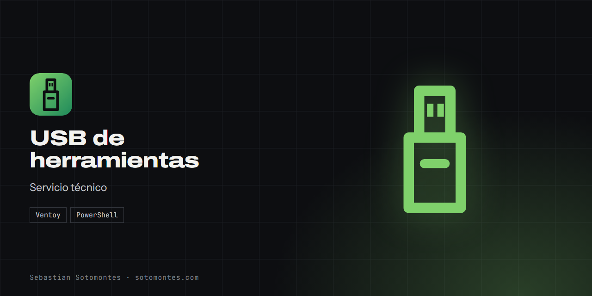
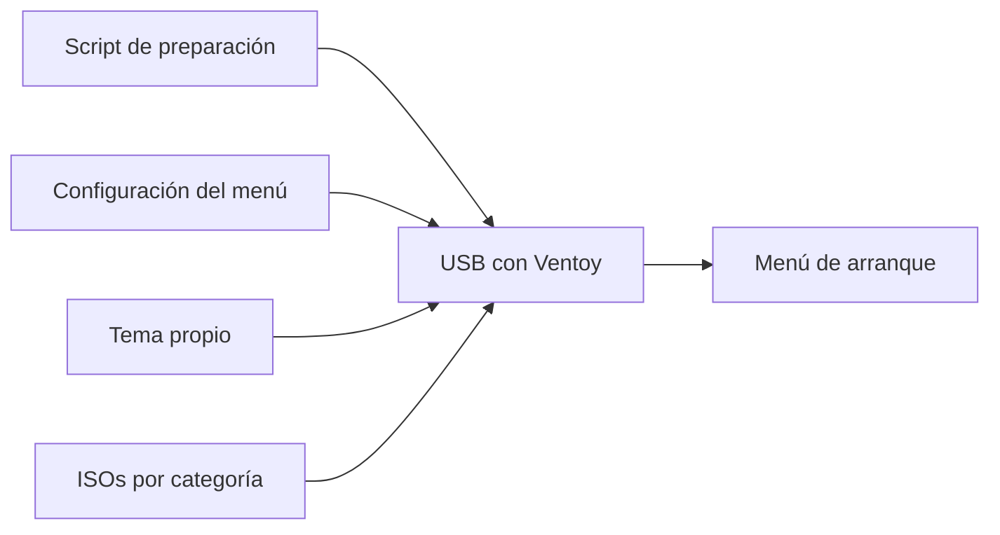

USB de servicio técnico con arranque múltiple y un menú propio ordenado por categorías.

<a href="https://sotomontes.com/#usb-de-herramientas"><b>Ver en sotomontes.com</b></a> · <a href="#cómo-se-usa">Cómo se usa</a> · <a href="#cómo-funciona-por-dentro">Cómo funciona</a> · <a href="#novedades">Novedades</a>

| Ficha técnica | |
|---|---|
| **Autor** | Sebastian Sotomontes |
| **Tipo** | Servicio técnico |
| **Plataforma** | Equipos UEFI y BIOS |
| **Versión** | Fase 1 |
| **Estado** | En desarrollo |
| **Stack** | Ventoy · PowerShell |
| **Código** | Privado. Esta página es solo una presentación. |

---

## Qué es

Una USB de servicio técnico que arranca cualquier herramienta desde un menú propio, ordenado por categorías y con la marca del servicio. Reúne diagnóstico, respaldo, Linux, Windows y antivirus en un solo dispositivo.

## Novedades

- Menú de arranque por categorías con tema propio.

## Cómo se usa

1. Instala Ventoy en la USB. Elige GPT para equipos UEFI o MBR para equipos viejos.
2. Ejecuta el script de preparación: encuentra la USB, crea las carpetas y copia el tema.
3. Copia cada ISO a su carpeta.
4. Arranca el equipo desde la USB y elige en el menú.

## Funciones

- **Arranque múltiple** con Ventoy.
- **Menú por categorías** con iconos y tema propio.
- **Preparación en un paso** con un script.
- **Iconos automáticos** según el nombre del archivo.

## Detalles

- Categorías: WinPE, diagnóstico, respaldo, Linux, Windows y antivirus.
- Si ya existía una configuración, se respalda antes de reemplazarla.
- Compatible con Secure Boot.

## Cómo funciona por dentro

### Arquitectura

### Cómo funciona

Ventoy arranca las ISO sin extraerlas. Su configuración define categorías, alias y tema, y cada archivo recibe su icono según su nombre.

**Créditos:** usa Ventoy.

---

© 2026 Sebastian Sotomontes. Todos los derechos reservados.
